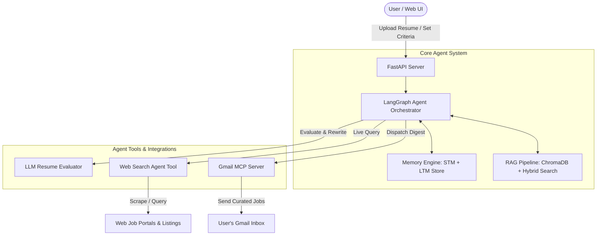

# HirePulse 🚀
### AI Job Hunter & Resume Optimizer Agent

[](https://github.com/the007prime/HirePulse)
[](https://python.org)
[](https://fastapi.tiangolo.com)
[](https://langchain-ai.github.io/langgraph/)

**HirePulse** is an intelligent, agentic career assistant built with **LangGraph**, **FastAPI**, **RAG**, and **Model Context Protocol (MCP)**. This system transforms the job search experience by evaluating and tailoring resumes to market trends, finding high-match job openings through live internet search, and delivering curated job digests directly to the user's inbox via Gmail MCP.

---

## 🎯 Key Capabilities & Objectives

### 1. 📄 Intelligent Resume Optimization & ATS Enhancement
- **Market Trend Alignment**: Analyzes the candidate's uploaded resume against current industry expectations, emerging technologies, and in-demand skills.
- **Keyword & Impact Enrichment**: Recommends targeted keywords, quantifiable metrics, and action verbs to maximize Applicant Tracking System (ATS) pass rates.
- **Comprehensive LLM Evaluation**: Evaluates resume clarity, structural strengths, technical depth, and experience gaps with an actionable score and improvement breakdown.

### 2. 🔍 Autonomous Job Hunter & Market Search
- **Live Internet Job Retrieval**: An agentic search tool queries live job boards, company career portals, and tech hiring platforms based on user criteria.
- **Preference-Based Matching**: Filters listings by user preferences (role, tech stack, location, remote/hybrid, experience level, compensation).
- **Profile-Driven Recommendations**: Identifies similar and adjacent roles suited to the candidate's transferable skills and career trajectory.

### 3. 📧 Automated Job Alerts via Gmail MCP
- **MCP Integration**: Connects via Model Context Protocol (MCP) to the Gmail service.
- **Curated Email Digests**: Generates clean, formatted email summaries featuring top job openings, direct application links, role highlights, and resume alignment notes.
- **One-Click / Scheduled Dispatch**: Supports instant dispatch or automated periodic job hunting updates sent to the user's email.

---

## 🏗️ System Architecture



---

## 📁 Modular Project Structure

The codebase is organized into cleanly separated modules under the `app/` package, ensuring separation of concerns, high testability, and easy extensibility:

```text
HirePulse/
├── app/
│   ├── config.py             # Centralized environment & app settings
│   ├── main.py               # FastAPI application factory & CORS setup
│   ├── api/
│   │   ├── routes/           # Modular endpoint routers
│   │   │   ├── chat.py       # Streaming SSE chat endpoint (/api/chat)
│   │   │   ├── threads.py    # Thread lifecycle & message history (/api/threads)
│   │   │   ├── documents.py  # Resume & document uploads (/api/documents/upload)
│   │   │   ├── memories.py   # Long-term preference management (/api/memories)
│   │   │   └── health.py     # System health check (/api/health)
│   │   └── schemas/          # Pydantic request/response validation schemas
│   ├── agent/
│   │   ├── graph.py          # LangGraph state machine & reasoning loop
│   │   ├── prompts.py        # System prompts & ATS resume evaluation guidelines
│   │   └── tools/            # Agent toolset (RAG retriever, memory, search)
│   ├── rag/
│   │   ├── pipeline.py       # Hybrid RAG engine (BM25 + Chroma + FlashRank)
│   │   ├── loaders.py        # Multi-format document parser (PDF, CSV, MD, TXT)
│   │   └── embeddings.py     # Shared Google GenAI embedding instance
│   └── memory/
│       ├── stm.py            # Short-Term Memory: SQLite checkpointer & token trimming
│       └── ltm.py            # Long-Term Memory: ChromaDB persistent user facts
├── Database/                 # Persistent SQLite & ChromaDB storage
├── frontend/                 # Vite + React user interface
├── server.py                 # Server entry point (uvicorn server:app)
├── chat_app.py               # Agent module entry point & CLI testing
└── test_rag_upload.py        # Automated test suite
```

---

## 🛠️ Tech Stack

- **Backend**: Python 3.11+, [FastAPI](https://fastapi.tiangolo.com/), Uvicorn
- **Agent Orchestration**: [LangGraph](https://langchain-ai.github.io/langgraph/), LangChain Core & Community
- **Memory & Storage**: 
  - Short-Term Memory (STM): LangGraph SQLite Checkpointer
  - Long-Term Memory (LTM): Persistent User Profile & Preference Vector Store
  - Vector DB: ChromaDB with Hybrid BM25 & FlashRank Reranker
- **External Tools & Protocols**:
  - Web Search: Live search tool (Tavily / Google Search / DuckDuckGo)
  - Integration Protocol: Model Context Protocol (MCP) - Gmail Server
- **Frontend**: Vite + React Chat & Dashboard Interface

---

## 📋 Project Roadmap & Implementation Plan

### Phase 1: Resume Analysis & ATS Optimization Module
- [ ] Add Resume Parsing schema (PDF/DOCX extraction via PyPDF / Document loaders).
- [ ] Implement `resume_evaluator` tool in LangGraph:
  - Match scoring against target job descriptions.
  - Identification of missing keywords, technologies, and action verbs.
  - Section-by-section enhancement suggestions.

### Phase 2: Autonomous Job Hunting & Web Search Agent
- [ ] Implement web search capability (e.g., Tavily / Serper / Search API) wrapped as an agent tool.
- [ ] Build search query generator that translates user profile + preferences into search prompts.
- [ ] Implement job listing extractor & parser (Job title, company, location, requirements, link).
- [ ] Rank job openings against the parsed resume using RAG similarity and re-ranking.

### Phase 3: Gmail MCP Integration
- [ ] Configure Gmail MCP client / server connection.
- [ ] Create `send_job_digest_email` tool accessible by the agent.
- [ ] Design HTML / Markdown email template presenting top jobs and match notes.

### Phase 4: UI & End-to-End Workflow Integration
- [ ] Update frontend UI to display:
  - Resume upload and interactive evaluation feedback.
  - Job preference setup (location, remote, salary, seniority).
  - Search results table with one-click "Email Me These Jobs" button.
- [ ] End-to-end testing of resume review, search, and email dispatch flows.

---

## 🚀 Getting Started

### 1. Prerequisites
- Python 3.10+
- Node.js & npm (for frontend)
- API Keys: Google Gemini API / OpenAI API, Search API (e.g. Tavily / Google), and Gmail MCP credentials.

### 2. Environment Setup
Create and configure your `.env` file:
```env
GOOGLE_API_KEY=your_gemini_api_key
OPENAI_API_KEY=your_openai_api_key
TAVILY_API_KEY=your_search_api_key
GMAIL_MCP_SERVER_URL=http://localhost:port # or stdio command configuration
```

### 3. Installation
```bash
# Clone the repository
git clone https://github.com/the007prime/HirePulse.git
cd HirePulse

# Create and activate virtual environment
python3 -m venv .myvenv
source .myvenv/bin/activate

# Install backend dependencies
pip install -r requirements.txt

# Install frontend dependencies
cd frontend && npm install && cd ..
```

### 4. Running the Application
```bash
# Start backend server
uvicorn server:app --reload --port 8000

# Start frontend development server (in a separate terminal)
cd frontend
npm run dev
```

---

